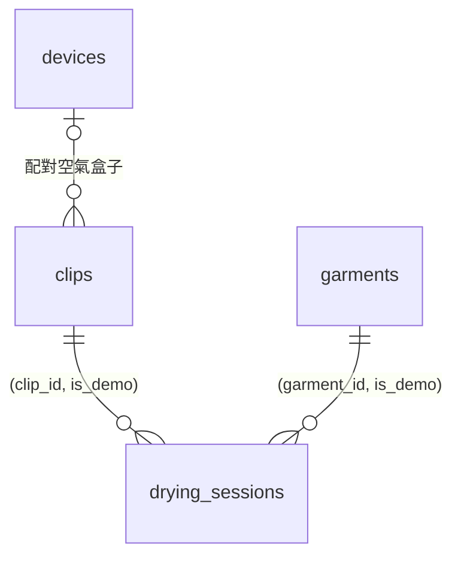

# 交接：後端資料表與 API

更新日期：2026-11-21。長期有效的專案說明在根目錄的 [CLAUDE.md](../CLAUDE.md)；這份文件只記錄目前進度和接下來要做的事，做完可以刪除。

## 目前狀態

- 分支 `feat/garments-sessions`，接在 `feat/clothes-redesign`（PR #12）後面開 PR（PR stack），要等 PR #12 合併後再合。照功能分成幾個 commit：全站設定 → 每支衣夾的設定 → 衣物庫和晾衣 → 示範資料進資料庫 → 前端接上 API 與標籤 → UUID 與名稱不重複。
- 實際的衣夾先照現在一支做：`clothes/raw`、`clothes_raw` 沒有改，`clips` 裡 `topic = clothes/raw` 的那支（衣夾-01）就是它。多衣夾之後另外開分支處理。

## 這一輪做好的部分

| 項目 | 後端 | 前端 |
| --- | --- | --- |
| 示範資料開關 | `app_settings.demo_data`，`/api/v1/settings` | 已接上：`useSettings.ts`，設定頁伺服器存好才切換 |
| 每支衣夾的設定（配對空氣盒子、預測方式、名稱） | `clips`，`GET/PATCH/DELETE /clothes/clips` | 已接上：空氣盒子選單、衣夾詳細的「預測使用」 |
| 衣物庫、晾衣中、晾衣紀錄 | `garments`、`drying_sessions`，`/clothes/garments`、`/clothes/sessions*` | 已接上：`useDrying.ts`，用衣夾-01 開始／換衣物／結束都會寫進資料庫 |
| 預測（預計乾燥時間） | 歷史平均，沒有紀錄用材質預設值（`prediction.ts`） | 已接上：衣夾-01 顯示伺服器的預測 |
| ID 與名稱 | 衣夾、衣物、晾衣改成資料庫產生的 UUID（舊的文字 id 啟動時自動轉換）；衣夾、衣物、空氣盒子的名稱不能重複（真假各自） | 衣夾網址 `/clips/<uuid>`；同名時表單先提示 |
| 示範資料 | 同一組表加 `is_demo`，複合 FK 保證真假不混；`make seed`、`POST /clothes/demo/reset` | 混在一起顯示並加「示範」標籤，統計只算真的 |

ER 圖：

`app_settings` 是獨立的 key-value 表；`clothes_raw` 和 session 用時間區間對應，不建 FK。
migration：`002_app_settings.sql`～`007_airbox_names.sql`（啟動時也會自動建表、補欄位、轉換舊 id）。

## 接下來要做的事

1. **統計**：前端目前只用真的紀錄自己算（`SessionsView.vue`），後端只有紀錄和 `total`。平均乾燥時間、誤差、各材質平均之後再決定怎麼做。
2. **剩餘水分 %**、用重量曲線修正預測：還沒做。
3. **多衣夾**：`clothes_raw` 加 `clip_id`、topic 改成可以分辨衣夾，`clips` 加列。新衣夾在 `clips` 加一列並填上自己的 `topic`；`listClips()` 的在線判斷和 `rawClipId()` 目前只看 `CLOTHES_MQTT_TOPIC` 這一個 topic，要改成依 topic 對應。
4. 其他沿用之前的清單：戶外天氣（`feat/outdoor-weather`）、連線事件、空夾歸零（韌體要先能收指令）。

## 驗證方式

- `make test`：後端單元測試，沒有資料庫時各端點應該回 503。
- 有資料庫時的完整流程（建衣物 → 開始 → 重複開始得 409 → 換衣物 → dry 結束 → 紀錄和 `dry_count` → cancel）已經用 curl 跑過；示範資料的過濾、真假混用 400、複合 FK、重設、`make seed` 重複執行也都測過。
- 瀏覽器：示範關閉時用衣夾-01 新增衣物、開始、以已乾結束，紀錄寫進資料庫；示範開啟時混著顯示並有標籤、衣夾-01 只列真的衣物；資料庫停掉時開始晾衣會顯示錯誤、不跳頁。
- 之前存在瀏覽器 `clothes-local-v1` 的紀錄不會自動搬到資料庫（也沒有刪掉）。
