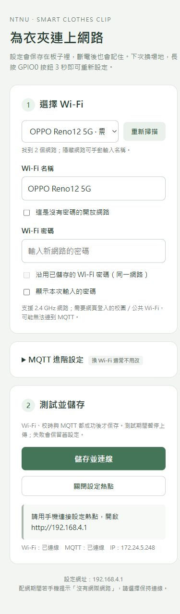

# ESP32-S3 原始資料韌體

硬體：ESP32-S3-N16R8；框架：ESP-IDF 6.1。

## 接線

| 模組 | 模組腳位 | ESP32-S3 |
| --- | --- | --- |
| HX711 | VCC / GND | 3V3 / GND |
| HX711 | DT / SCK | GPIO4 / GPIO5 |
| ADS1115 | VDD / GND | 3V3 / GND |
| ADS1115 | SDA / SCL | GPIO8 / GPIO9 |
| ADS1115 | ADDR | GND（0x48） |
| ADS1115 | A0 | 分壓交會點 |
| touch 電極 | 感測線 | GPIO10 |

ADS1115 分壓：`3V3 → 1 MΩ（精密電阻）→ A0 → 電極 → 布料 → 電極 → GND`，A0 接鱷魚夾和 1 MΩ 的一端。網頁的電阻歐姆值要在衣夾詳細頁的「電阻換算」填分壓電阻與開路讀值（電極之間什麼都沒夾時的讀值）。所有模組共地。A1/A2/A3/ALRT 不接。Touch 電極沿用隔著絕緣膠帶接觸布料的方式。

## 量測頻率、雜訊過濾與睡眠

- 每 **60 秒**回報一次（`APP_REPORT_PERIOD_MS`），兩次之間深度睡眠，HX711 透過 SCK 拉高進入省電。
- 每次回報連續讀 HX711 **10 次取中位數**，ADS1115 讀 3 次取中位數，touch 讀 4 次平均。單點突波與讀取失敗（接近 0 的值）不會影響中位數。
- 10 次讀值去掉最高、最低後的差距超過 1000，表示有人在碰衣夾：改成每 **10 秒**量一次（`APP_TOUCHED_PERIOD_MS`），連續 3 次穩定再回到 60 秒。
- MQTT 用 QoS 1，收到 broker 確認才睡；醒來直接連上次的 AP（記在 RTC 記憶體），失敗才重新掃描全部頻道。
- 以下情況不睡、但頻率相同：USB 接著電腦（方便看序列埠、輸入 `setup`）、設定熱點開著、按著 GPIO0、還沒有可用設定。量耗電請用行動電源或充電器供電。
- `APP_DEEP_SLEEP 0` 可關閉睡眠。舊的 `APP_SAMPLE_PERIOD_MS` 已不使用，本機 `app_config.h` 留著也沒關係。

ADS1115 使用 ±4.096 V PGA、128 SPS、單端 A0；送出的仍是 ADC 計數。GPIO10 touch 使用 ESP32-S3 硬體讀值；不換算成 pF。HX711 不套用校正係數或歸零。

## 手機換 Wi-Fi（不用重新燒錄）

1. 按住板上的 **GPIO0／BOOT 約 3 秒**，再放開。板子在睡眠中也可以直接按：按下會喚醒，繼續按滿 3 秒就開熱點。不要按住它再上電或按 reset，那是燒錄模式。
2. 手機連上 `Clothes-Setup-xxxx`，熱點密碼預設 **`12345678`**（可在 `app_config.h` 用 `APP_SETUP_AP_PASSWORD` 修改，8–63 字元）。USB 115200 訊息也會顯示。
3. 瀏覽器開啟 **http://192.168.4.1**。若手機提示沒有網際網路，選擇繼續使用這個 Wi-Fi。
4. 選擇附近的 2.4 GHz Wi-Fi，或手動輸入隱藏網路名稱。輸入新密碼；開放網路勾選「沒有密碼」。同一個已保存網路可以勾選沿用密碼。
5. 平常換 Wi-Fi 不必改 MQTT；需要更換伺服器時再展開「MQTT 進階設定」，調整 broker、port、TLS、帳號、密碼與 topic。
6. 按「儲存並連線」。板子依序測試 Wi-Fi、TLS 校時、MQTT 登入，全部成功才寫入 NVS。成功 8 秒後設定熱點關閉，開始定時上傳。

失敗或取消測試時保留舊設定，設定熱點繼續開放，可以修改重試。設定存在板子的 NVS，拔電仍保留；已保存的設定優先於 `app_config.h`，日後換網路請用設定頁。短暫斷線會自動重連，不會自動暴露配網熱點。沒有可用初始設定時才會自動開啟配網；熱點閒置 10 分鐘自動關閉。

熱點使用 WPA2，但密碼是固定預設值，附近知道密碼的人在熱點開啟期間都能連入設定頁；熱點只在長按 GPIO0 或沒有設定時開啟，閒置 10 分鐘關閉。正式場合請在 `app_config.h` 改成自己的密碼。設定 API 只允許從設定熱點存取，修改請求需要本次配網 token；已保存的 Wi-Fi／MQTT 密碼不回傳給瀏覽器。NVS 目前使用一般 Flash 儲存，沒有啟用 Flash encryption。電阻／電容／重量取樣持續，測試新設定期間暫停 MQTT 發送。

USB 監看時輸入 `setup` 加 Enter，也能開啟熱點並再次顯示熱點名稱與密碼。這是開發／測試替代入口，不需要修改接線。



## 衣夾編號與 topic

每支衣夾用自己 ESP32 的 Wi-Fi MAC（12 碼，例如 `FC012CD245E0`）當編號，資料送到 `clothes/<編號>/raw`，不用設定 topic。開機時 USB 會印出編號，手機配網頁面的「伺服器設定」裡也看得到。伺服器收到新編號的第一筆資料，網頁上就會自動多一支衣夾。

所以一支新衣夾只要設定 Wi-Fi 和 MQTT 主機（位址、port、帳號、密碼）就能用。

## 遠端更新韌體（OTA）

在網頁「設備狀況」的衣夾區塊按「更新韌體」，選 `build/hx711_scale.bin`，再選衣夾。

- 衣夾平常在睡眠，下次醒來回報後才會看到更新指令，所以按下去後最多要等一個回報週期。
- 衣夾從伺服器設定的 `FIRMWARE_HTTP_HOST` 與 `FIRMWARE_HTTP_PORT` 用 HTTP 下載映像檔；未設定主機時才沿用 MQTT 主機。下載位址應使用衣夾可連線的區網位址，不要將未加密的韌體下載埠公開到 Internet。
- 新韌體開機後要成功送出一筆資料才算數；送不出去就在下次開機時自動退回舊韌體。同一個映像檔最多試 3 次。
- 版本號在 `CMakeLists.txt` 的 `PROJECT_VER`，每次發佈請改。網頁顯示的是這個字串，但判斷是否已更新是看映像檔的雜湊，忘了改也不會漏更新。
- 分割表在 `partitions.csv`（兩個 3 MB 的韌體區）。**從舊的單一韌體區版本換過來時，要先用 USB 燒一次**，之後才能遠端更新；NVS 位置沒變，Wi-Fi 設定會保留。

## 多台基地台的網路

宿舍這類網路，同一個 SSID 有很多台基地台，而且不同基地台底下的裝置可能互相連不到。衣夾連上 Wi-Fi 但連續兩次回報都連不到 MQTT 主機時，會改連同 SSID 的另一台基地台，並避開試過不通的。上次連得通的那台會記在 NVS，重新上電時優先使用。

## 首次編譯與燒錄

1. 複製 `main/app_config.example.h` 為 `main/app_config.h`。
2. 可全部先留空，首次開機用手機設定；也可填入 APP_WIFI_SSID、APP_WIFI_PASSWORD、APP_MQTT_HOST、APP_MQTT_PORT、APP_MQTT_USERNAME、APP_MQTT_PASSWORD，作為尚未配網時的初始設定。
3. 使用本機 Docker 時，MQTT host 填電腦的區網 IP，帳密與根目錄 .env 一致；遠端服務則填網域與服務提供的帳密。儲存過手機設定後，以 NVS 設定為準。

### 遠端 MQTT TLS

使用遠端 broker 時，host 填網域名稱（不含 `https://`），並依服務設定 port 與帳密。例如目前展示服務：

```c
#define APP_MQTT_HOST "iot.hamichi.tw"
#define APP_MQTT_PORT 8883
#define APP_MQTT_TLS  1
```

帳密可填在本機 `app_config.h` 作為初始值，或在手機設定頁輸入後保存到 NVS；不要提交實際帳密。TLS 使用 ESP-IDF CA bundle 驗證憑證與主機名稱，連線前透過 SNTP 校時；Wi-Fi 必須能連外並使用 NTP。校時只供憑證驗證，MQTT payload 仍只有三個 raw 欄位，沒有裝置時間。

本機非 TLS broker 使用 `APP_MQTT_TLS 0` 與 port 1883。韌體一次只送到設定的 broker；改送遠端後，本機 Docker broker 不會自動收到副本。

SSID 或 MQTT host 留空、且板子沒有可用的 NVS 設定時，會自動開啟配網熱點。實際設定檔不提交 Git。程式分割區使用 ESP-IDF 的 single-app large（1500 KiB），NVS 位置維持不變；正常 flash 不會清除已保存設定。

在已啟用 ESP-IDF 6.1 的 terminal，進入此資料夾：

```sh
idf.py set-target esp32s3
idf.py build
idf.py -p COM7 flash monitor
```

COM7 改成實際連接埠，Linux/macOS 改為對應 serial device。序列埠 115200，Ctrl+] 離開 monitor。

### Windows 中文路徑

在 repository 根目錄執行：

```powershell
& firmware/esp32-s3/tools/idf.ps1 build
& firmware/esp32-s3/tools/idf.ps1 -IdfArgs @('-p', 'COM7', 'flash', 'monitor')
```

工具將程式複製到 `C:\esp\ntnu-iot-firmware` 編譯，以避開 ESP-IDF 對中文路徑的限制。可用環境變數 NTNU_IDF_BUILD_DIR 指定另一個英文路徑。若未啟用環境，會嘗試這台開發機的 ESP-IDF 6.1 activation script；其他電腦請先開 ESP-IDF PowerShell。

## 看數值

USB log 每次回報顯示 HX711、ADS1115、touch raw 值與 HX711 10 次讀值的差距（spread）。Wi-Fi/MQTT 連線成功後開啟 `http://<server-IP>:8088` 即可看 DB 最新值與歷史曲線。

不需要按歸零、乾布 baseline 或校正；目前就是觀察讀值如何變化。缺少感測器或讀取失敗會傳 null。斷線自動重連，只傳新讀值，不補送離線期間資料。

遠端 broker 的接收驗證可在 repository 根目錄執行 `python tools/mqtt_tls_monitor.py`。這個工具會從本機 `app_config.h` 讀取帳密（不是板子的 NVS），以系統信任的 CA 驗證 TLS，訂閱同一 topic 後顯示最多五筆資料；不發送測試讀值。若手機已更換 broker，請確保監看工具的本機設定也對應該 broker。

### 配網實機測試（Windows）

使用含 pyserial 的 Python（例如 ESP-IDF Python）執行 `tools/smoke_setup_windows.py`。需插上 USB 並讓 Windows 先連上一個已保存的 Wi-Fi profile；工具暫時切換到板子的設定熱點，結束時自動切回原 profile。請從 PowerShell 或 cmd 執行；工具解析英文的 `netsh` 輸出，Git Bash 下 `netsh` 會輸出中文而無法解析。板子連上其他頻道的 AP 時設定熱點會跟著換頻道，手機或電腦會短暫斷線，工具會自動重連。

- `--mode inspect`：設定頁、掃描、密碼遮蔽、無效 token／參數拒收。
- `--mode cancel`、`--mode fail`：取消與錯誤 SSID 回復。
- `--mode mqtt-fail`：可用 Wi-Fi 但錯誤 broker，不覆蓋舊設定。
- `--mode success --ssid <開放網路名稱>`：真實配網並保存，這項會改變板子設定。
- 重開板子後 `--mode persist --ssid <相同名稱>`：確認 NVS 保存。

工具只測設定 API，不發送假感測資料；測試記錄為被 gitignore 的 `.log`，AP 連線資訊只存在本機暫存目錄。GPIO0 長按的實體操作需以板上按鍵確認。
