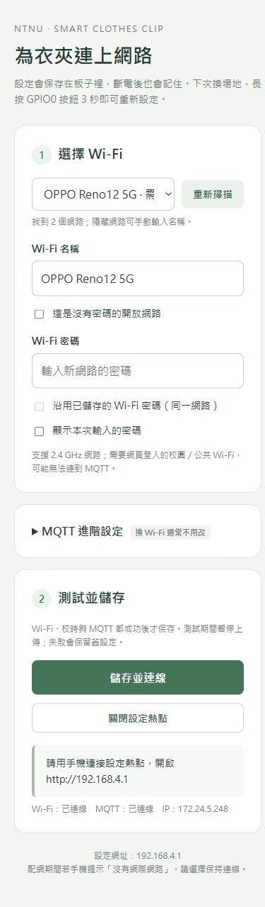

# ESP32-S3 原始資料韌體

硬體：ESP32-S3-N16R8；框架：ESP-IDF 6.1。

## 接線

| 模組 | 模組腳位 | ESP32-S3 |
| --- | --- | --- |
| HX711 | VCC / GND | 3V3 / GND |
| HX711 | DT / SCK | GPIO4 / GPIO5 |
| ADS1115 | VDD / GND | 3V3 / GND |
| ADS1115 | SDA / SCL | GPIO8 / GPIO9 |
| ADS1115 | ADDR | GND（0x48） |
| ADS1115 | A0 | 分壓交會點 |
| touch 電極 | 感測線 | GPIO10 |

ADS1115 分壓：`3V3 → 10kΩ → A0 → 布料兩電極 → GND`。所有模組共地。A1/A2/A3/ALRT 不接。Touch 電極沿用隔著絕緣膠帶接觸布料的方式。

ADS1115 使用 ±4.096 V PGA、128 SPS、單端 A0；送出的仍是 ADC 計數。GPIO10 touch 使用 ESP32-S3 硬體讀值；不換算成 pF。HX711 不套用校正係數或歸零。

## 手機換 Wi-Fi（不用重新燒錄）

1. 正常開機後，按住板上的 **GPIO0／BOOT 約 3 秒**，再放開。不要按住它再上電，那是燒錄模式。
2. 手機連上 `Clothes-Setup-xxxx`。每台板子有獨立的 16 字元熱點密碼，首次可從 USB 115200 訊息取得；熱點密碼會保存，重開機不變。
3. 瀏覽器開啟 **http://192.168.4.1**。若手機提示沒有網際網路，選擇繼續使用這個 Wi-Fi。
4. 選擇附近的 2.4 GHz Wi-Fi，或手動輸入隱藏網路名稱。輸入新密碼；開放網路勾選「沒有密碼」。同一個已保存網路可以勾選沿用密碼。
5. 平常換 Wi-Fi 不必改 MQTT；需要更換伺服器時再展開「MQTT 進階設定」，調整 broker、port、TLS、帳號、密碼與 topic。
6. 按「儲存並連線」。板子依序測試 Wi-Fi、TLS 校時、MQTT 登入，全部成功才寫入 NVS。成功 8 秒後設定熱點關閉，開始每秒上傳。

失敗或取消測試時保留舊設定，設定熱點繼續開放，可以修改重試。設定存在板子的 NVS，拔電仍保留；已保存的設定優先於 `app_config.h`，日後換網路請用設定頁。短暫斷線會自動重連，不會自動暴露配網熱點。沒有可用初始設定時才會自動開啟配網；熱點閒置 10 分鐘自動關閉。

熱點有 WPA2 密碼保護，設定 API 只允許從設定熱點存取，修改請求需要本次配網 token；已保存的 Wi-Fi／MQTT 密碼不回傳給瀏覽器。NVS 目前使用一般 Flash 儲存，沒有啟用 Flash encryption。電阻／電容／重量取樣持續，測試新設定期間暫停 MQTT 發送。

USB 監看時輸入 `setup` 加 Enter，也能開啟熱點並再次顯示熱點名稱與密碼。這是開發／測試替代入口，不需要修改接線。



## 首次編譯與燒錄

1. 複製 `main/app_config.example.h` 為 `main/app_config.h`。
2. 可全部先留空，首次開機用手機設定；也可填入 APP_WIFI_SSID、APP_WIFI_PASSWORD、APP_MQTT_HOST、APP_MQTT_PORT、APP_MQTT_USERNAME、APP_MQTT_PASSWORD，作為尚未配網時的初始設定。
3. 使用本機 Docker 時，MQTT host 填電腦的區網 IP，帳密與根目錄 .env 一致；遠端服務則填網域與服務提供的帳密。儲存過手機設定後，以 NVS 設定為準。

### 遠端 MQTT TLS

使用遠端 broker 時，host 填網域名稱（不含 `https://`），並依服務設定 port 與帳密。例如目前展示服務：

```c
#define APP_MQTT_HOST "iot.hamichi.tw"
#define APP_MQTT_PORT 8883
#define APP_MQTT_TLS  1
#define APP_MQTT_TOPIC "clothes/raw"
```

帳密可填在本機 `app_config.h` 作為初始值，或在手機設定頁輸入後保存到 NVS；不要提交實際帳密。TLS 使用 ESP-IDF CA bundle 驗證憑證與主機名稱，連線前透過 SNTP 校時；Wi-Fi 必須能連外並使用 NTP。校時只供憑證驗證，MQTT payload 仍只有三個 raw 欄位，沒有裝置時間。

本機非 TLS broker 使用 `APP_MQTT_TLS 0` 與 port 1883。韌體一次只送到設定的 broker；改送遠端後，本機 Docker broker 不會自動收到副本。

SSID 或 MQTT host 留空、且板子沒有可用的 NVS 設定時，會自動開啟配網熱點。實際設定檔不提交 Git。程式分割區使用 ESP-IDF 的 single-app large（1500 KiB），NVS 位置維持不變；正常 flash 不會清除已保存設定。

在已啟用 ESP-IDF 6.1 的 terminal，進入此資料夾：

```sh
idf.py set-target esp32s3
idf.py build
idf.py -p COM7 flash monitor
```

COM7 改成實際連接埠，Linux/macOS 改為對應 serial device。序列埠 115200，Ctrl+] 離開 monitor。

### Windows 中文路徑

在 repository 根目錄執行：

```powershell
& firmware/esp32-s3/tools/idf.ps1 build
& firmware/esp32-s3/tools/idf.ps1 -IdfArgs @('-p', 'COM7', 'flash', 'monitor')
```

工具將程式複製到 `C:\esp\ntnu-iot-firmware` 編譯，以避開 ESP-IDF 對中文路徑的限制。可用環境變數 NTNU_IDF_BUILD_DIR 指定另一個英文路徑。若未啟用環境，會嘗試這台開發機的 ESP-IDF 6.1 activation script；其他電腦請先開 ESP-IDF PowerShell。

## 看數值

USB log 每秒顯示 HX711、ADS1115、touch raw 值。Wi-Fi/MQTT 連線成功後開啟 `http://<server-IP>:8088` 即可看 DB 最新值與歷史曲線。

不需要按歸零、乾布 baseline 或校正；目前就是觀察讀值如何變化。缺少感測器或讀取失敗會傳 null。斷線自動重連，只傳新讀值，不補送離線期間資料。

遠端 broker 的接收驗證可在 repository 根目錄執行 `python tools/mqtt_tls_monitor.py`。這個工具會從本機 `app_config.h` 讀取帳密（不是板子的 NVS），以系統信任的 CA 驗證 TLS，訂閱同一 topic 後顯示最多五筆資料；不發送測試讀值。若手機已更換 broker，請確保監看工具的本機設定也對應該 broker。

### 配網實機測試（Windows）

使用含 pyserial 的 Python（例如 ESP-IDF Python）執行 `tools/smoke_setup_windows.py`。需插上 USB 並讓 Windows 先連上一個已保存的 Wi-Fi profile；工具暫時切換到板子的設定熱點，結束時自動切回原 profile。

- `--mode inspect`：設定頁、掃描、密碼遮蔽、無效 token／參數拒收。
- `--mode cancel`、`--mode fail`：取消與錯誤 SSID 回復。
- `--mode mqtt-fail`：可用 Wi-Fi 但錯誤 broker，不覆蓋舊設定。
- `--mode success --ssid <開放網路名稱>`：真實配網並保存，這項會改變板子設定。
- 重開板子後 `--mode persist --ssid <相同名稱>`：確認 NVS 保存。

工具只測設定 API，不發送假感測資料；測試記錄為被 gitignore 的 `.log`，AP 連線資訊只存在本機暫存目錄。GPIO0 長按的實體操作需以板上按鍵確認。
